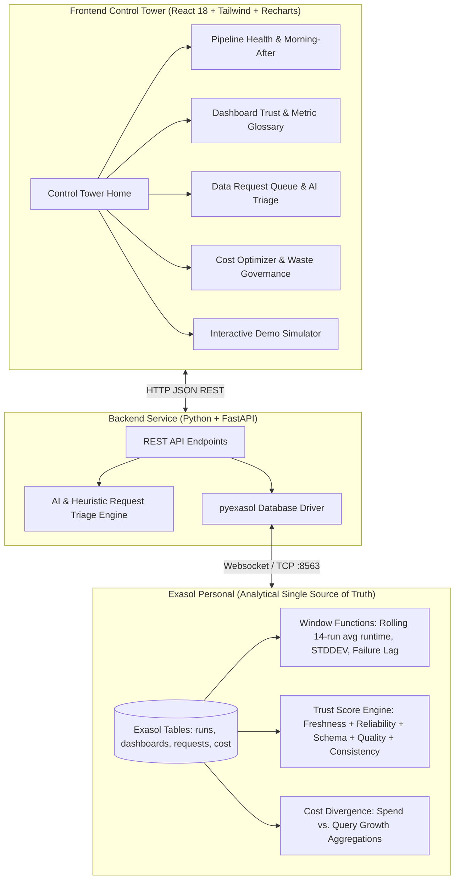

# PlatformPulse — Control Tower for Internal Data & IT Teams
### Hackathon Track: *"The Work Behind the Work"*
**Core Analytical Database: Exasol Personal**

---

## 📌 Problem Statement: Who Has It & Why It Matters

In modern organizations, internal data teams (data engineers, analytics engineers, platform architects) are the unsung infrastructure backbone — **"the work behind the work"**. When they succeed, executives get trustworthy numbers; when they struggle, the entire company flies blind.

Today, data teams face four compounding operational crises:
1. **Pipelines Fail Overnight Without Warning**: Batch ETL and dbt runs fail at 3 AM due to upstream API schema drift or rate limits. Data engineers wake up to angry Slack messages from the C-suite whose 8 AM dashboards are stale.
2. **Dashboards the Business No Longer Trusts**: When silent data errors, null spikes, or contradictory metric formulas slip through (e.g. Finance calculates Net ARR differently from Sales CRM), business stakeholders lose faith in reporting and start making decisions on gut feeling.
3. **Data Requests Queue for Weeks**: Ad-hoc requests flood Jira/Slack with no visibility. Up to 40% of these requests could be answered immediately by an existing certified dashboard, but lack of discovery leads to endless backlogs and duplicated pipelines.
4. **Platform Cost Grows Faster Than Usage**: Cloud warehouse bills (Snowflake, BigQuery, Databricks) spike uncontrollably. Over-provisioned warehouses run 24/7 with 6% CPU utilization, and zombie dashboards refresh hourly for users who left the company months ago.

**PlatformPulse solves this with a unified control tower powered by Exasol Personal as the high-speed analytical single source of truth.**

---

## 🏗 System Architecture



### Why Exasol Personal?
Exasol Personal provides the sub-second in-memory columnar query engine needed to analyze millions of execution logs, warehouse query logs, and cross-system dependency graphs in real-time. 

**All scoring and analytics are executed in SQL (window functions, CTEs, analytical views) rather than application code:**
- **Rolling Failure Risk (`v_pipeline_failure_risk`)**: Computed using `AVG(duration_sec) OVER (PARTITION BY pipeline_id ORDER BY run_start ROWS BETWEEN 14 PRECEDING AND 1 PRECEDING)` and `STDDEV` to catch runtime variance before failure strikes.
- **Trust Score Engine (`v_dashboard_trust_score`)**: 5-pillar weighted 0–100 score computed completely in SQL, synthesizing freshness, 30-day pipeline success rates, schema modifications, and null check anomalies.
- **Cost vs. Usage Divergence (`v_cost_usage_divergence`)**: Uses `LAG()` window functions to prove when cloud spend (+69%) outpaces query volume (+17%).

---

## 🚀 Core Modules

### 1. Pipeline Health & Morning-After View
- **16 Pre-Seeded Pipelines**: Categorized across Bronze, Silver, Gold, ML, and Streaming.
- **Predictive Failure Risk**: Flags pipelines with rising runtimes (`+68%`), retry spikes (`3/3`), or upstream API throttling.
- **Morning-After View**: Isolates overnight outages (e.g. Stripe API schema drift `billing_country_iso2`) with one-click hotfix deployment.
- **Terminal Execution Logs**: Timestamped container logs and stack trace viewer.
- **Simulated Slack/Email Incident Alert**: Realistic Slack card with PagerDuty acknowledgement and hotfix trigger.

### 2. Dashboard Trust Score & Metric Governance
- **8 Pre-Seeded Dashboards**: Monitored with automated 0–100 trust scores and visible status badges: *Trusted (≥85)*, *Use with caution (60–84)*, and *Stale (<60)*.
- **Drill-Down Modal**: 5-pillar breakdown with upstream pipeline links and recent anomaly alerts.
- **Metric Glossary & Conflict Detector**: Flags KPI definition conflicts (e.g. **Net ARR**: $1.2M variance between Finance and Sales CRM, **Active Users**: 38% difference between Exec and Product) with one-click standard enforcement.

### 3. Data Request Queue & AI Triage
- **Intake Portal**: Business user intake form capturing objective, urgency (P1 to P4), and target deadline.
- **AI Triage Engine**: Auto-classifies requests into:
  - *Already Answerable*: Matches certified dashboards with instant previews to deflect duplicate pipeline work.
  - *Quick Query (<2h)*: Direct SQL extracts.
  - *Needs New Pipeline*: Scopes engineering effort in hours and priority score.
- **5-Column Kanban Board**: Backlog, AI Triaged, In Progress, QA / Review, Delivered with live SLA timers and bottleneck alerts.

### 4. Platform Cost Optimizer & Waste Governance
- **Spend vs. Usage Divergence (Recharts)**: 6-month historical trend showing spend climbing 69% while queries grew only 17%.
- **Multi-Dimensional Breakdown**: Slice spend by warehouse engine (*Snowflake 52%, BigQuery 28%, Databricks 20%*), business teams, and storage tiers.
- **Waste Detection Cards**: Over-provisioned compute (`BI_ANALYTICS_XL`), zombie dashboards (0 views in 94 days), untouched staging tables, and duplicate pipelines.
- **1-Click Approvals**: Interactive actions that dynamically update the **Realized Monthly Savings** counter (up to **$7,820/mo**).

### 5. Interactive Demo Scenario
Click **"⚡ Run Demo Scenario"** to simulate the complete overnight domino catastrophe and chain reaction:
1. `pipeline_stripe_billing_sync` fails overnight due to schema drift.
2. Downstream *Executive Revenue & ARR Overview* trust score drops from 94 to 48 (**Stale**).
3. Automated P1 Slack incident alert dispatched to `#data-incidents`.
4. CEO flags revenue mismatch; auto-ticket `REQ-004` is injected into the Request Queue.
5. Unbudgeted compute rerun costs logged in Cost Optimizer.
6. Click **"Apply 1-Click Fix"** to heal the pipeline, restore trust to 96/100, close the ticket in Exasol, and celebrate with confetti!

---

## 🗄 Exasol Personal Setup Guide

PlatformPulse is designed to connect natively to **Exasol Personal** using the high-performance `pyexasol` websocket client.

### Option A: Local Docker Container (Recommended)
Exasol Personal runs locally as a single Docker container:

```bash
# 1. Pull and run Exasol Personal (Community Edition / Exasol 8)
docker run --name platformpulse-exasol -p 8563:8563 --privileged -d exasol/docker-db:8

# 2. Wait 30 seconds for Exasol to initialize
docker logs -f platformpulse-exasol

# 3. Verify connection via python
python -c "import pyexasol; C = pyexasol.connect(dsn='localhost:8563', user='sys', password='exasol'); print(C.meta.current_schema()); C.close()"
```

### Option B: Exasol Cloud (AWS / Azure)
1. Deploy an **Exasol Cloud instance** from the [AWS Marketplace](https://aws.amazon.com/marketplace/pp/prodview-szu5kvd7wepve) or [Azure Marketplace](https://azuremarketplace.microsoft.com/en-us/marketplace/apps/exasol.exasol).
2. Set the environment variables in your `.env` or terminal:
   ```bash
   export EXASOL_DSN="<your-exasol-ip-or-dns>:8563"
   export EXASOL_USER="sys"
   export EXASOL_PASSWORD="<your-password>"
   export EXASOL_SCHEMA="PLATFORMPULSE"
   ```

### Option C: Built-in Local Engine Fallback
If you run PlatformPulse without an active Exasol instance, the built-in **Local Compatibility Engine** automatically activates. It executes identical SQL schemas, window functions, and views using embedded SQLite 3.45, ensuring hackathon evaluators can test the entire application immediately without setup friction.

---

## ⚡ Quick Start

### One-Command Setup (Docker Compose)
```bash
docker compose up --build
```
- Frontend UI: [http://localhost:5173](http://localhost:5173)
- FastAPI Docs: [http://localhost:8000/docs](http://localhost:8000/docs)
- Exasol Personal: `localhost:8563`

### Manual Run
```bash
# 1. Seed Database
python backend/seed.py

# 2. Start Backend API
uvicorn backend.main:app --host 127.0.0.1 --port 8000 --reload

# 3. Start Frontend UI
cd platformpulse
npm install
npm run dev
```
Open **[http://127.0.0.1:5173/](http://127.0.0.1:5173/)** in your browser.
